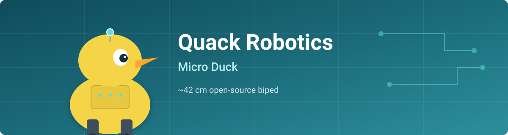
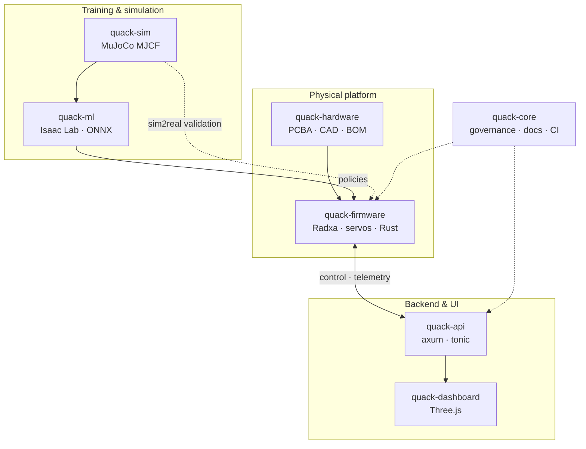
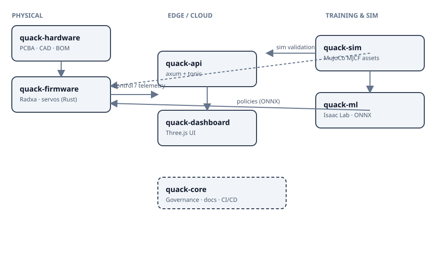

<div align="center">



### Open-source bipedal stack for a ~42&nbsp;cm duck-inspired robot.

**Micro Duck** builds on [Open Duck Mini v2](https://github.com/apirrone/Open_Duck_Mini) by [apirrone](https://github.com/apirrone) (Apache-2.0).

</div>

---

## What we're building

[Quack Robotics](https://github.com/QuackRobotics) is a multi-repo effort to design, simulate, train, and operate **Micro Duck** — an open-source biped with PCBA and mechanical CAD, Rust firmware on Radxa with servo drivers, a fleet-oriented **axum** + **tonic** backend, **MuJoCo** simulation assets, **Isaac Lab** training with **ONNX** export, and a **Three.js** dashboard. Repository layout, governance, and shared CI live in [**quack-core**](https://github.com/QuackRobotics/quack-core).

## Repositories

| | Repository | Focus |
|:---:|:---|:---|
|  | [**quack-core**](https://github.com/QuackRobotics/quack-core) | Monorepo root, governance, docs, CI/CD |
|  | [**quack-hardware**](https://github.com/QuackRobotics/quack-hardware) | PCBA, mechanical CAD, BOM, assembly |
|  | [**quack-firmware**](https://github.com/QuackRobotics/quack-firmware) | Radxa + servo driver firmware (Rust) |
|  | [**quack-api**](https://github.com/QuackRobotics/quack-api) | Backend API, fleet management, auth |
|  | [**quack-ml**](https://github.com/QuackRobotics/quack-ml) | ML training, policies, domain randomization |
|  | [**quack-sim**](https://github.com/QuackRobotics/quack-sim) | MuJoCo MJCF simulation, sim2real |
|  | [**quack-dashboard**](https://github.com/QuackRobotics/quack-dashboard) | Web dashboard and visualization |

<details>
<summary><strong>Clone all public repos</strong></summary>

```bash
gh repo list QuackRobotics --limit 50 --json name -q '.[].name' \
  | xargs -I {} gh repo clone QuackRobotics/{}
```

</details>

## Architecture

How the seven repositories connect in the Micro Duck stack:



<p align="center">
  
</p>

## Tech stack

<p align="center">
  
  
  
  
  
  
  
</p>

## Community & docs

- **Governance & contributing:** see [quack-core/GOVERNANCE.md](https://github.com/QuackRobotics/quack-core/blob/main/GOVERNANCE.md) and [CONTRIBUTING.md](https://github.com/QuackRobotics/quack-core/blob/main/CONTRIBUTING.md)
- **GitHub Discussions:** RFCs, design questions, announcements (per quack-core README)
- **License mix:** Apache-2.0 software, CERN-OHL-S 2.0 hardware, CC-BY-SA 4.0 docs — details in [quack-core](https://github.com/QuackRobotics/quack-core/blob/main/README.md)

---

<p align="center">
  <sub>Derived from Open Duck Mini v2 · <a href="https://github.com/QuackRobotics/quack-core/blob/main/NOTICE">NOTICE</a></sub>
</p>